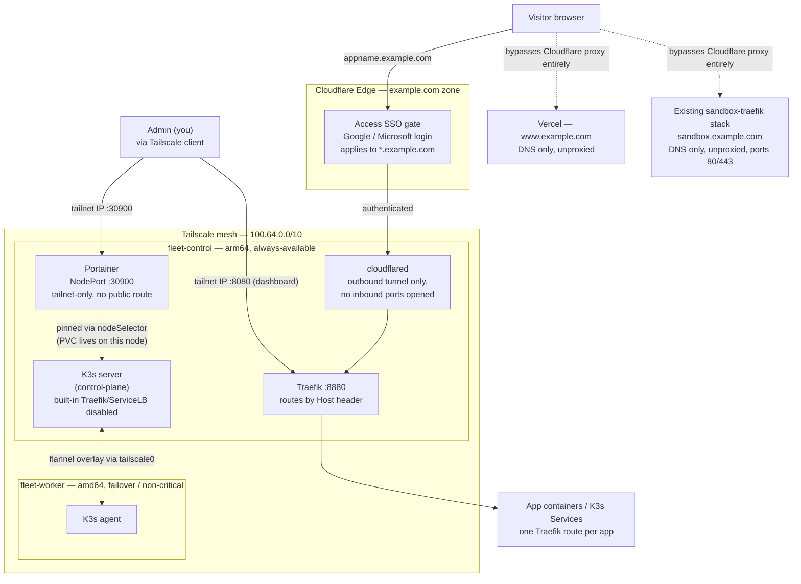

# ArcoreFleet Infrastructure Setup Guide

A step-by-step runbook for standing up the hybrid homelab + cloud ingress
stack: Tailscale mesh, Traefik reverse proxy, Cloudflare Tunnel, Cloudflare
Access (SSO email gate), and supporting DNS/email hardening. Written so it
can be followed again for a **new domain and new servers** — every
domain-specific or server-specific value is called out so it can be
swapped.

## Reference values used in this deployment

Substitute your own values for a new deployment; these are what this
specific environment used, for context when reading the steps below.

| Placeholder              | Value used here                          |
|---------------------------|-------------------------------------------|
| Root domain               | `example.com`                          |
| App hostname pattern      | `appname.example.com`                  |
| Registrar (pre-Cloudflare)| Namecheap                                 |
| Primary ingress node      | `fleet-control` (Oracle Cloud, ARM/aarch64, free tier) |
| Secondary/failover node   | `fleet-worker` (homelab, x86_64)              |
| Traefik web port on ingress node | `8880` (80/443 already used by a prior stack) |
| Email provider            | Microsoft 365                             |
| Existing website host     | Vercel (`www`)                            |
| K3s server (control-plane)| `fleet-control` (arm64) — the always-available node |
| K3s agent                 | `fleet-worker` (amd64)                        |
| Portainer access          | `http://<server-tailscale-ip>:30900` — tailnet-only, not public |

## Architecture summary



**Two separate access paths, deliberately kept apart:**
- **Public app traffic** always goes Internet → Cloudflare (DNS + Access
  gate) → Tunnel → Traefik → app. No inbound ports are ever opened on any
  node.
- **Admin access** (Portainer, the Traefik dashboard) goes directly over
  Tailscale, never through Cloudflare at all — these tools have far too
  much blast radius to sit behind just a login page on the public
  internet.

`www` and `sandbox` are intentionally **unproxied** (DNS only) so
Cloudflare just answers DNS for them like the old registrar did — they
never touch the Tunnel, Traefik, or the Access policy at all.

Tailscale is a **separate, private layer** — it connects your own nodes to
each other (and lets you SSH/administer them), it is not how the public
reaches anything. Public access always goes through the Cloudflare Tunnel.

---

## Phase 0 — DNS: get the domain onto Cloudflare

### Why full migration, not just a subdomain
Cloudflare's self-serve "Connect your domain" onboarding **rejects
subdomain-only zones** — it requires the root domain. (An older
"partial/CNAME setup" for subdomain-only zones exists but is Enterprise-only
now.) So the whole domain moves to Cloudflare, not just a `dev.` prefix.

### Why app hostnames are one level deep, not two
The free Cloudflare **Universal SSL** certificate only covers **one level**
of subdomain: `example.com` and `*.example.com`. It does **not** cover a
second level like `*.dev.example.com` — any hostname two levels deep (exact
or wildcard) gets a TLS handshake failure at Cloudflare's edge, because no
certificate matches. Covering two levels requires the paid **Advanced
Certificate Manager (ACM)** add-on (~$10/mo).

**Decision:** use `appname.example.com` directly (one level), not
`appname.dev.example.com`, to stay on the free tier. If a client wants a
`dev.`/`staging.` prefix, budget for ACM instead.

### Cost tradeoff: ACM vs. just buying another domain

Multiple apps on their own do **not** require either option — they all
fit at one level under the existing free zone (`app1.example.com`,
`app2.example.com`, ...). This decision only matters when you specifically
want an extra naming *level*: an environment prefix (`dev.`/`staging.`),
or a dedicated domain per client for white-labeling.

ACM runs ~$10/mo (~$120/yr) per zone. A new domain registration typically
runs $10-20/yr. That means **buying a domain is cheaper than ACM for
roughly the first 6-12 domains** you'd otherwise have avoided buying by
using ACM's multi-level wildcard instead. Past that point (a lot of
distinct environments/clients on one root domain), ACM's flat fee wins.

| | **Pay for ACM** (~$120/yr, one zone) | **Buy another domain** (~$10-20/yr each) |
|---|---|---|
| Best for | Many environments/subtenants under *one* brand (`dev.`, `staging.`, per-tenant prefixes) | A handful of distinct environments, or a dedicated domain per client project |
| Pros | One zone to administer; unlimited depth/wildcards; also unlocks Total TLS (auto per-hostname certs) and more cert/cipher control; no extra renewals | Much cheaper per added "namespace" up to ~6-12 domains; each client/project can get real, ownable branding instead of a subdomain; zero new Cloudflare spend, free tier stays sufficient; natural fit if Arcore is already doing dedicated-domain client work |
| Cons | Recurring SaaS cost that compounds forever across every client zone you'd apply it to; still tied to the single root domain's branding | More renewal dates/invoices to track; more Cloudflare zones to onboard (each ~5 min, one-time); doesn't help if you truly need deep nested structure (e.g. `tenant.dev.example.com`) — that still needs ACM eventually |
| Breakeven | Cheaper once you'd otherwise buy >~8-12 domains/yr to avoid it | Cheaper below that — and often the better fit for a dev shop running many separate client projects anyway |

**Recommendation for ArcoreFleet's current shape** (single org, apps added
one at a time, no urgent need for a `dev.` prefix): stay on free tier with
one-level hostnames, as implemented. Revisit ACM only if a specific need
for nested/environment subdomains comes up on a single domain; otherwise
prefer registering a cheap dedicated domain per client project when that
need is for separate branding rather than environments.

### Steps
1. **Before touching anything**, note the domain's current nameservers at
   the registrar (so you can revert if something breaks).
2. **Cloudflare dashboard → Connect your domain** → enter the **root
   domain** (e.g. `example.com`, not `dev.example.com`) → Free plan →
   Continue.
3. Leave **Import DNS records** on **Automatic**. Cloudflare scans the
   domain's current live records.
4. **Verify every existing record matches exactly** before proceeding —
   this is the only point where you can fix a missed/wrong record before
   DNS authority moves. For this deployment that meant checking the
   website A/CNAME, the Microsoft 365 `autodiscover` CNAME, and the SPF
   TXT record all imported correctly.
5. Set every existing record's proxy status to **DNS only** (grey cloud).
   This makes Cloudflare answer identically to the old registrar — no
   behavior change to the live site/email. Only new app hostnames get
   proxied (orange cloud) later.
6. Cloudflare shows two nameservers for the zone (e.g.
   `leah.ns.cloudflare.com`, `trace.ns.cloudflare.com`).
7. **At the registrar**, switch nameservers to Cloudflare's — on Namecheap
   this is **Domain List → the domain → Nameservers dropdown** (not the
   Advanced DNS tab, which only edits individual records) → **Custom DNS**
   → enter both nameservers → save. This is the actual cutover moment.
8. Wait for Cloudflare to show the zone as **Active** (minutes to a few
   hours).
9. **Verify nothing broke**: load the live website, send a test email to
   confirm mail still flows.

### Email hardening while you're in here (optional but recommended)
With SPF already in place (common when mail is Microsoft 365/Google
Workspace), add:
- **DKIM**: enable in the mail provider's admin console (e.g. Microsoft
  Defender → Email & collaboration → Policies → DKIM). It gives you two
  CNAME records to publish (`selector1._domainkey`, `selector2._domainkey`
  → provider-specific targets). Add them as **DNS only** (unproxied) — a
  proxied CNAME breaks DKIM verification. Sync after publishing can take
  minutes up to several days; retry the "enable" step later if it errors
  immediately.
- **DMARC**: add a `_dmarc` TXT record. Cloudflare has a built-in DMARC
  Management feature that generates a report-collection address for you:
  ```
  Type:  TXT
  Host:  _dmarc
  Value: v=DMARC1; p=none; rua=mailto:<cloudflare-provided-address>@dmarc-reports.cloudflare.net
  ```
  Start with `p=none` (monitor only). After a couple of weeks of clean
  reports in Cloudflare's Email Security dashboard, tighten to
  `p=quarantine` then `p=reject`.

---

## Phase 1 — Tailscale mesh

Connects every node (homelab + cloud) into one private network for
administration and inter-node traffic. Not used for public access.

1. **ACL policy** — paste into https://login.tailscale.com/admin/acls/file
   (replacing the default). Modern Tailscale accounts use the `grants`
   syntax, not the older `acls` array:
   ```json
   {
       "tagOwners": {
           "tag:homelab":     ["autogroup:admin"],
           "tag:cloud":       ["autogroup:admin"],
           "tag:arcorefleet": ["autogroup:admin"],
       },
       "grants": [
           {
               "src": ["tag:homelab", "tag:cloud", "tag:arcorefleet"],
               "dst": ["tag:homelab", "tag:cloud", "tag:arcorefleet"],
               "ip":  ["*"],
           },
       ],
       "ssh": [
           {
               "action": "check",
               "src":    ["autogroup:admin"],
               "dst":    ["tag:homelab", "tag:cloud", "tag:arcorefleet"],
               "users":  ["autogroup:nonroot", "root"],
           },
       ],
   }
   ```
2. **Generate an auth key**: https://login.tailscale.com/admin/settings/keys
   → Generate auth key → enable **Reusable**, leave **Ephemeral** off.
3. **On each node**, install and join:
   ```bash
   curl -fsSL https://tailscale.com/install.sh | sh
   sudo tailscale up \
     --authkey="tskey-auth-..." \
     --hostname="<node-name>" \
     --advertise-tags="tag:homelab"   # or tag:cloud for the cloud node \
     --accept-dns=true \
     --ssh
   ```
4. Confirm: `tailscale status` should list every joined node with its
   `100.x.y.z` tailnet IP.

### Remote access setup note
If an existing SSH key for a cloud node lives on a different machine (e.g.
a Windows laptop) than the one you're orchestrating from, generate a new
dedicated keypair on the orchestrating machine and append its **public**
key to the target's `~/.ssh/authorized_keys` — don't copy private key
material between machines/into a chat session. Watch for line-wrapping
when pasting a key manually: an `authorized_keys` entry must be a single
line; a key split across multiple lines by a terminal/paste is silently
invalid and causes `Permission denied (publickey)` with no other error.

---

## Phase 2 — Traefik (reverse proxy)

1. **Check which ports are free on the target node first**:
   ```bash
   sudo ss -ltn
   ```
   Don't assume 80/443 are available — this deployment found an existing
   unrelated Traefik stack already bound to them, so the new instance was
   moved to host port `8880` instead. Since TLS terminates at Cloudflare's
   edge (see Phase 3), this Traefik instance doesn't need port 80/443 or
   its own ACME/Let's Encrypt setup at all.
2. **Static config** (`traefik.yml`):
   ```yaml
   entryPoints:
     web:
       address: ":80"      # maps to whatever host port is free, e.g. 8880:80
     traefik:
       address: ":8080"    # dashboard

   api:
     dashboard: true
     insecure: true        # fine: this entrypoint is bound to loopback only

   providers:
     docker:
       exposedByDefault: false
     file:
       directory: /etc/traefik/dynamic
       watch: true

   log:
     level: INFO
   accessLog: {}
   ```
3. **Dashboard access control** (dynamic file, restricts the dashboard to
   the tailnet CGNAT range):
   ```yaml
   http:
     middlewares:
       tailnet-only:
         ipWhiteList:
           sourceRange:
             - "100.64.0.0/10"
             - "127.0.0.1/32"
     routers:
       traefik-dashboard:
         rule: "PathPrefix(`/dashboard`) || PathPrefix(`/api`)"
         entryPoints: ["traefik"]
         service: api@internal
         middlewares: ["tailnet-only"]
   ```
4. **docker-compose.yml**:
   ```yaml
   services:
     traefik:
       image: traefik:v3.1
       container_name: traefik
       restart: unless-stopped
       ports:
         - "8880:80"               # adjust host port to whatever is free
         - "127.0.0.1:8080:8080"
       volumes:
         - ./traefik.yml:/etc/traefik/traefik.yml:ro
         - ./dynamic:/etc/traefik/dynamic:ro
         - /var/run/docker.sock:/var/run/docker.sock:ro
       command:
         - "--configFile=/etc/traefik/traefik.yml"
   ```
5. `docker compose up -d`, then verify: `curl -o /dev/null -w '%{http_code}' http://localhost:<port>/` should return `404` (correct — no app routers defined yet).

Per-app routes are added later as individual files in the `dynamic/`
directory (or Docker labels), one per app — see Phase 5.

---

## Phase 3 — Cloudflare Tunnel (public ingress, no port-forwarding)

1. **Install cloudflared** (Debian/Ubuntu apt repo):
   ```bash
   sudo mkdir -p --mode=0755 /usr/share/keyrings
   curl -fsSL https://pkg.cloudflare.com/cloudflare-main.gpg | sudo tee /usr/share/keyrings/cloudflare-main.gpg >/dev/null
   echo "deb [signed-by=/usr/share/keyrings/cloudflare-main.gpg] https://pkg.cloudflare.com/cloudflared $(lsb_release -cs) main" \
     | sudo tee /etc/apt/sources.list.d/cloudflared.list
   sudo apt-get update && sudo apt-get install -y cloudflared
   ```
2. **Authenticate** (opens a URL to approve in any browser, on any device —
   does not require a GUI on the server itself):
   ```bash
   cloudflared tunnel login
   ```
3. **Create the tunnel and route DNS**:
   ```bash
   cloudflared tunnel create <tunnel-name>
   cloudflared tunnel route dns <tunnel-name> "*.example.com"
   ```
   This automatically creates the proxied wildcard CNAME in Cloudflare DNS
   — no manual DNS record needed.
4. **Config** (`/etc/cloudflared/config.yml`):
   ```yaml
   tunnel: <tunnel-id>
   credentials-file: /etc/cloudflared/<tunnel-id>.json
   ingress:
     - hostname: "*.example.com"
       service: http://localhost:8880   # Traefik's actual port on this node
     - service: http_status:404
   ```
5. **Register as a systemd service**:
   ```bash
   sudo mkdir -p /etc/cloudflared
   sudo cp ~/.cloudflared/<tunnel-id>.json /etc/cloudflared/
   sudo cloudflared service install
   sudo systemctl enable --now cloudflared
   ```
6. **Verify end-to-end** from any machine with internet access:
   ```bash
   curl -v https://anything.example.com/
   ```
   Expect a successful TLS handshake and a `404` from Traefik (correct —
   no app registered at that hostname yet). A TLS handshake failure here
   almost always means the two-levels-of-subdomain certificate problem
   described in Phase 0 — check the hostname is one level deep.

---

## Phase 4 — Cloudflare Access (Google/Microsoft email gate)

Gates every hostname behind the tunnel so visitors must authenticate with
an allowed Google or Microsoft account before Traefik ever sees the
request. Managed via Terraform for repeatability.

### One-time manual prerequisites (console UIs, can't be scripted)
1. **Enable Zero Trust** on the Cloudflare account, pick a team name (e.g.
   `example`). This fixes the OAuth callback URL:
   `https://<team-name>.cloudflareaccess.com/cdn-cgi/access/callback`
2. **Google OAuth client** (console.cloud.google.com → APIs & Services →
   Credentials → Create OAuth client ID → Web application → redirect URI
   = the callback above). Copy the Client ID + Secret.
3. **Microsoft (Azure AD) app registration** (portal.azure.com → App
   registrations → New registration → redirect URI = same callback → API
   permissions: `email`, `openid`, `profile` → Certificates & secrets →
   new client secret). Copy the Application (client) ID, Directory
   (tenant) ID, and secret **value** (shown once).
4. **Cloudflare API token** scoped to `Account.Access: Edit`:
   ```bash
   export CLOUDFLARE_API_TOKEN=cf-token-here
   ```

### Terraform

**Note on provider version**: the `cloudflare/cloudflare` v5 provider
changed this resource's schema significantly from v4 — `config` is now an
attribute (`config = { ... }`), not a block, and policies nest *inline*
inside the application's `policies` list instead of being a separate
`cloudflare_zero_trust_access_policy` resource linked by `application_id`.
If `terraform plan` errors with "Unsupported block type" or "Missing
required argument" on these resources, you're looking at v4-style syntax
against a v5 provider — use the form below instead. When in doubt, run
`terraform providers schema -json` after `init` to check the installed
provider's actual schema rather than guessing from older examples.

```hcl
resource "cloudflare_zero_trust_access_identity_provider" "google" {
  account_id = var.cloudflare_account_id
  name       = "Google"
  type       = "google"
  config = {
    client_id     = var.google_client_id
    client_secret = var.google_client_secret
  }
}

resource "cloudflare_zero_trust_access_identity_provider" "microsoft" {
  account_id = var.cloudflare_account_id
  name       = "Microsoft"
  type       = "azureAD"
  config = {
    client_id     = var.azure_client_id
    client_secret = var.azure_client_secret
    directory_id  = var.azure_tenant_id
  }
}

resource "cloudflare_zero_trust_access_application" "wildcard" {
  account_id       = var.cloudflare_account_id
  name             = "Apps"
  domain           = "*.example.com"
  type             = "self_hosted"
  session_duration = "24h"
  allowed_idps = [
    cloudflare_zero_trust_access_identity_provider.google.id,
    cloudflare_zero_trust_access_identity_provider.microsoft.id,
  ]
  auto_redirect_to_identity = false

  # Policies nest inline here in v5 (no separate resource/application_id).
  # Each include entry is OR'd together.
  policies = [
    {
      name       = "Allow authorized accounts"
      decision   = "allow"
      precedence = 1
      include = concat(
        [for e in var.allowed_emails : { email = { email = e } }],
        [for d in var.allowed_email_domains : { email_domain = { domain = d } }],
      )
    }
  ]
}
```
`terraform init && terraform apply` with `terraform.tfvars` filled in
(never commit this file — it holds OAuth secrets).

### Critical safety rule
Any existing hostname at the **same subdomain level** as the wildcard (in
this deployment: `www`, `sandbox`) must stay **DNS only / unproxied**.
This isn't just theoretical — it broke live production here: both had
drifted to Proxied (likely a default from the Phase 0 DNS import) and it
went unnoticed until Access was actually applied, at which point the
public website and sandbox stack both started redirecting to the Access
login. Explicitly verify proxy status on every existing hostname
immediately after applying this Terraform, not just once during Phase 0.
Access only intercepts traffic actually proxied through Cloudflare's edge
— if an existing hostname is ever switched to Proxied, it immediately
starts matching the wildcard and falls behind the login gate too.

---

## Phase 5 — Internal DNS (Pi-hole) and per-app routing

### Pi-hole: per-app, not domain-wide
Add a local override **per app hostname**, not a wildcard for the whole
root domain:
```bash
echo "address=/<app-hostname>/<ingress-tailscale-ip>" | sudo tee -a /etc/dnsmasq.d/02-arcorefleet.conf
sudo pihole restartdns
```
A domain-wide wildcard (`address=/example.com/...`) would hijack internal
lookups for every other subdomain under that root — including `www` and
`sandbox` in this deployment — redirecting internal clients to the wrong
place. Scope it to exactly the one hostname being added.

### Adding a new app
1. Point the app's container at the ingress node over the tailnet.
2. Add a Traefik dynamic-config file (or Docker labels) routing
   `Host(\`appname.example.com\`)` to that container's tailnet IP:port.
3. (Optional) Add the Pi-hole override above so internal clients skip the
   round-trip through Cloudflare.
4. No DNS or tunnel changes needed — the wildcard CNAME and Access policy
   from Phases 3-4 already cover any new hostname under the root domain.

---

## Project Phase 2 — Hybrid K3s cluster & Portainer

(This is the project's overall "Phase 2" — distinct from the "Phase 0-5"
steps above, which together make up project Phase 1: Network & Ingress.)

### Node roles
Pick the K3s **server** (control-plane) based on availability, not which
node happens to be "primary" by convention — if the control-plane node
goes down, no new pods can be scheduled anywhere in the cluster, even if
agent nodes are still healthy. In this deployment, the always-available
cloud node (`fleet-control`) runs the server; the homelab node
(`fleet-worker`) joined as an agent.

### Bootstrap
Both nodes must already be on the Tailscale mesh (Phase 1 above).

**Server** (on the always-available node):
```bash
curl -sfL https://get.k3s.io | INSTALL_K3S_EXEC="server \
  --node-ip=<server-tailscale-ip> \
  --advertise-address=<server-tailscale-ip> \
  --tls-san=<server-tailscale-ip> \
  --flannel-iface=tailscale0 \
  --disable traefik \
  --disable servicelb \
  --write-kubeconfig-mode 644" sh -
```
`--flannel-iface=tailscale0` is what makes pod-to-pod traffic cross nodes
over the tailnet instead of trying to use a LAN interface that doesn't
reach the cloud node. `--disable traefik --disable servicelb`: skip K3s's
bundled ingress controller and load-balancer — Phase 1's standalone
Traefik already handles ingress, and a second one would fight over ports.

Grab the join token: `sudo cat /var/lib/rancher/k3s/server/node-token`

**Agent** (on every other node):
```bash
curl -sfL https://get.k3s.io | K3S_URL="https://<server-tailscale-ip>:6443" \
  K3S_TOKEN="<node-token>" \
  INSTALL_K3S_EXEC="agent --node-ip=<this-node-tailscale-ip> --flannel-iface=tailscale0" sh -
```

Verify: `sudo k3s kubectl get nodes -o wide` should list every node as
`Ready`, with mixed `OS-IMAGE`/architecture columns confirming the
multi-arch mix (e.g. one `arm64`, one `amd64`).

### Before deploying anything: check for port/stack collisions
Don't assume a "fresh" cloud node is actually empty. This deployment found
an *existing, unrelated* Traefik stack already running on the intended
K3s/ingress node, bound to 80/443. Always check first:
```bash
sudo ss -ltn
docker ps
```

### Portainer
Deploy via a plain Kubernetes manifest (see
`phase2-k3s-portainer/portainer.yaml` in this repo for the full version) —
namespace, ServiceAccount + ClusterRoleBinding (`cluster-admin`, required
for Portainer to manage the cluster), a PVC, a Deployment pinned to the
reliable node via `nodeSelector`, and a `NodePort` Service.

**Do not expose Portainer through Traefik/the public Tunnel without a
gate in front of it.** It has cluster-admin access to everything. This
deployment initially routed it through Traefik to
`portainer.<domain>` for convenience, then had to reverse that the same
day once the risk was pointed out — the NodePort already wasn't reachable
from the public internet (the cloud host's own firewall rejects
unsolicited inbound traffic on it by default; verify this with a direct
`curl` to `http://<public-ip>:<nodeport>/` from an outside network before
relying on it), so removing the Traefik route alone was sufficient to
make it tailnet-only: reachable at `http://<server-tailscale-ip>:<nodeport>`
from any device on the mesh, nowhere else. If public access is wanted
later, put it behind Cloudflare Access (Phase 4) first.

Portainer's first-login admin-password setup has a short time window
(a few minutes) after the container starts — if you miss it, restart the
pod to get a fresh window.

---

## Troubleshooting index

| Symptom | Likely cause | Fix |
|---|---|---|
| Cloudflare onboarding shows a red error on a subdomain | Self-serve zones require the root domain | Add the root domain instead (Phase 0) |
| TLS handshake failure (`SSL routines::sslv3 alert handshake failure`) hitting an app hostname | Hostname is two levels deep; Universal SSL only covers one | Use a one-level hostname, or pay for ACM |
| `docker compose up` fails with "port is already allocated" | Another stack already owns 80/443 on this node | `sudo ss -ltn` to check first; move the new Traefik to a free port |
| SSH `Permission denied (publickey)` right after adding a key | Key got line-wrapped when pasted into `authorized_keys` | Confirm the key is exactly one line in the file |
| Microsoft DKIM enable fails immediately after publishing the CNAMEs | Sync can take minutes to 4 days | Wait and retry; not necessarily an error |
| `terraform plan` errors "Unsupported block type" / "Missing required argument" on Access resources | v4-style syntax against the v5 provider schema | Use attribute syntax (`config = {...}`) and inline `policies` — see Phase 4; or run `terraform providers schema -json` to check |
| Public site/other existing hostname suddenly redirects to Cloudflare's Access login after applying Access | It drifted to Proxied (orange cloud) instead of DNS only | Switch it back to DNS only in the zone's DNS tab; re-verify every existing hostname's proxy status right after every Access apply, not just once in Phase 0 |
| An admin tool (Portainer, K8s dashboard, etc.) is reachable at a public URL protected by nothing but its own login | It got a Traefik route to the public Tunnel like any other app, without a gate in front of it | Don't route cluster-admin tools through the public Tunnel at all — use the tailnet (NodePort/ClusterIP + Tailscale) for admin access, or put Cloudflare Access in front of it first |
